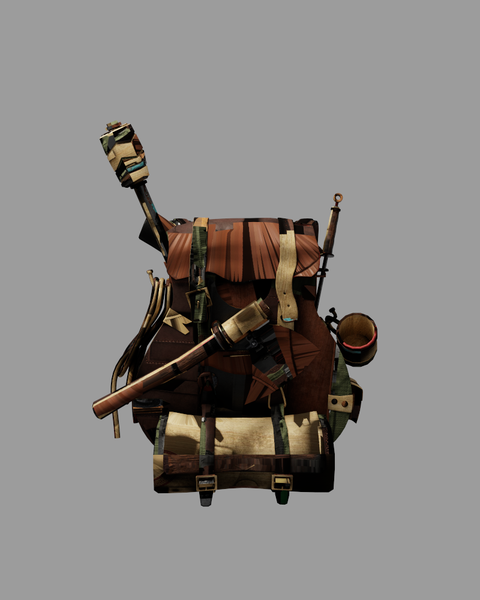

# Raytracing

一个 C++ / OpenGL 渐进路径追踪实验项目，由 2025 年本科实现整理而来。现在修复了 HDR 累积、采样与资源管理，并支持带贴图的 OBJ / glTF / GLB / PMX 静态模型。

**项目自有代码采用 [MIT](LICENSE)；模型、贴图与 vendored 依赖保留各自许可。** 背包使用 CC BY 素材；外部人物模型不随仓库分发。详见 [第三方声明](THIRD_PARTY_NOTICES.md) 与 [视频发布说明](docs/LICENSING.md)。

*Survival Guitar Backpack — Berk Gedik，CC BY 4.0；Joey de Vries 调整材质/贴图命名；本项目重新解释 PBR 贴图并渲染。[来源与完整署名](THIRD_PARTY_NOTICES.md#bundled-backpack-model-and-textures)。*

## 运行与操作

要求支持 **OpenGL 4.3 Core** 的显卡和驱动。本次已在 Windows / MSVC Release / RTX 5070 上验证。程序使用 GPU 上的软件 BVH 求交，没有使用 RTX RT Core。

~~~powershell
.\build\Release\rtrt.exe
.\build\Release\rtrt.exe --scene assets/backpack/backpack.obj
~~~

- **右键按住观察**。默认灵敏度为 `0.04°/鼠标单位`，是旧版的三分之一；Camera controls 可调。
- **WASD** 移动，**Q/E** 世界竖直升降，**Shift** 加速，**Ctrl** 精细观察/移动，**Esc** 退出。
- 偏航保持世界竖直，俯仰限制 ±89°；捕获鼠标时丢弃初始位移，失焦释放，不再累积滚转。
- Adaptive preview 在移动时最多用 50% 宽高，静止约 0.15 秒后恢复设置的分辨率。
- 相机、反弹数、环境光、视图和尺寸变化会重置累积；曝光保留 HDR 样本。
- View 可切换 Path tracing / Albedo / Shading normal；便于判断贴图与法线问题。
- 支持暂停、相机复位、曝光、反弹数、环境亮度、渲染比例、目标 spp 和保存画面。暂停时更改场景会生成一个新样本供预览。
- Save PPM + HDR 输出到 `captures/`：色调映射 PPM、线性浮点 PFM、参数与 GPU 时间 JSON。

查看全部命令：

~~~powershell
.\build\Release\rtrt.exe --help
~~~

## 构建

安装 Visual Studio 2022 的 C++ 桌面开发组件、Windows SDK、CMake 3.22 或以上。`lib/` 是已包含的 vendored 源码树，无需额外下载模型或初始化 submodule。

~~~powershell
cmake --preset windows-release
cmake --build --preset windows-release
ctest --preset windows-release
~~~

也可运行 `build_inWindows.bat`。GitHub Actions 验证 Windows 编译与 CPU 合约；真实 OpenGL 测试需在有 GPU 上下文的桌面运行。GLM 的旧 CMake 策略弃用提示不影响本次构建。

其他编译器可用普通 CMake 配置，本次未验证其他平台。资源默认从编译时源码根目录读取；移动源码后重新配置构建，或用 `--root` 指定包含 `shaders/` 与 `assets/` 的目录。Windows 模型、贴图、输出和资源路径支持 Unicode。

## 贴图与 PMX

- Base color 纹理使用 sRGB 解码，normal / roughness / metallic / AO / opacity 数据保持线性。
- UV0 插值、切线空间法线、alpha mask 与随机覆盖率透明；透明几何也参与阴影与穿透。
- 背包 `specular.jpg` 按原包说明还原为 metallic；额外加载 roughness 与 AO 图。
- 缺失或损坏的引用贴图会明确失败，避免悄悄输出没有纹理的模型。
- `--attachment` 可重复指定，按模型原始坐标合并。它不自动绑骨骼或装配武器。

~~~powershell
$modelDir = 'D:\Models\Character'
.\build\Release\rtrt.exe --scene "$modelDir\诺姆1.pmx"
.\build\Release\rtrt.exe --scene "$modelDir\诺姆1.pmx" --attachment "$modelDir\武器.pmx"
~~~

本次对外部人物验证了全部静态几何、颜色与 alpha：主体 45,818 三角形 /30 材质 /5 张颜色图；加武器共 54,468 三角形 /31 材质 /6 张颜色图。**这不等于复现 MMD 的骨骼动画、物理、toon/sphere 或所有材质表现。** 原包条款与署名必须保留，人物资产、转换副本及本地渲染缓存不会上传。

## 可复现出图与测试

~~~powershell
.\build\Release\rtrt.exe --headless --scene assets/backpack/backpack.obj --width 800 --height 1000 --frames 1024 --environment 0.18 --exposure 0.3 --output captures/backpack.ppm
.\build\Release\rtrt.exe --headless --width 960 --height 600 --frames 4096 --bounces 6 --seed 1 --output captures/cubes.ppm
~~~

默认每帧每像素一个样本；`--frames` 是帧数，`--scale` 乘在宽高上。<=64 三角形默认直接求交，大场景使用分桶 SAH BVH；可用 `--force-bvh` / `--brute-force` 对照。相同种子在本次相同 GPU/驱动环境中可复现，未承诺跨驱动逐位一致。

图像回归需要 Python、NumPy 和 Pillow，测试图均在本地生成：

~~~powershell
python tests/validate_render.py
python tests/validate_textures.py
python tests/validate_textures.py --character "$modelDir\诺姆1.pmx"
~~~

报告、命令、日志、PFM 和 PNG 位于 ignored `captures/`；默认模型本地已有，不联网下载资产。Python 仅用于可选验证，C++ 程序运行不依赖 Python。

- [第一轮渲染核心修复报告](docs/RENDERER_REPAIR.md)
- [贴图、相机与模型验收](docs/TEXTURES_AND_CAMERA.md)
- [历史整理与本地恢复](docs/HISTORY.md)

## 当前边界

纹理使用显式 LOD0，尚无 mipmap / 各向异性过滤；只支持 UV0，未实现 glTF 纹理变换或多 UV。AO 对间接路径作艺术性衰减，并非独立物理测量。透明覆盖率不等于玻璃折射。

尚无模型自发光、导入灯光、HDRI、体积、运动模糊、骨骼动画、物理和降噪。灯光是程序布置的矩形面积光与常量环境。硬反弹上限、最小粗糙度与简化平滑法线处理也限制物理精度。
